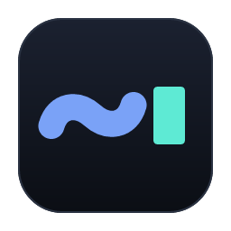
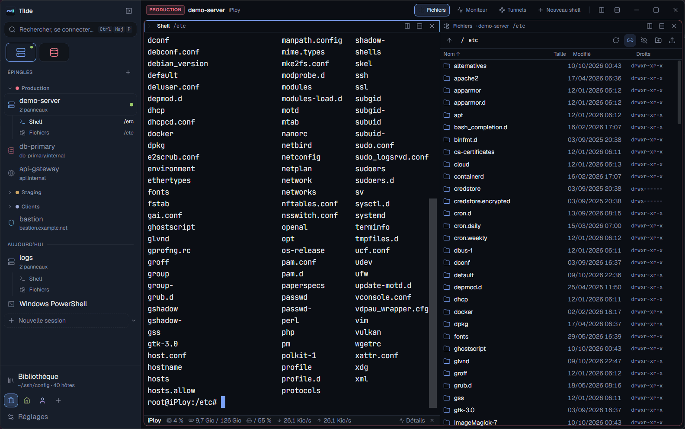
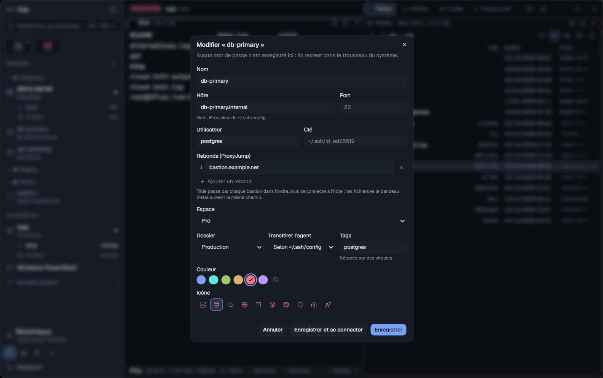
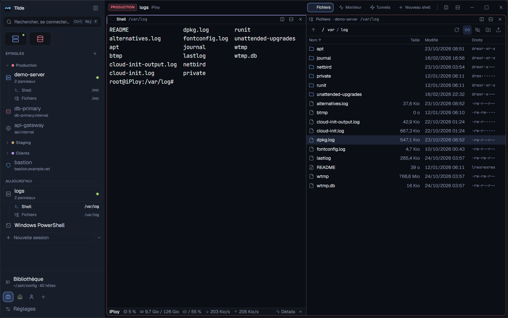
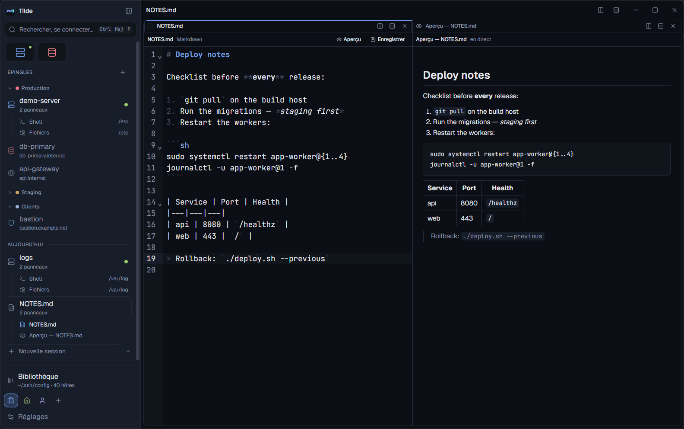
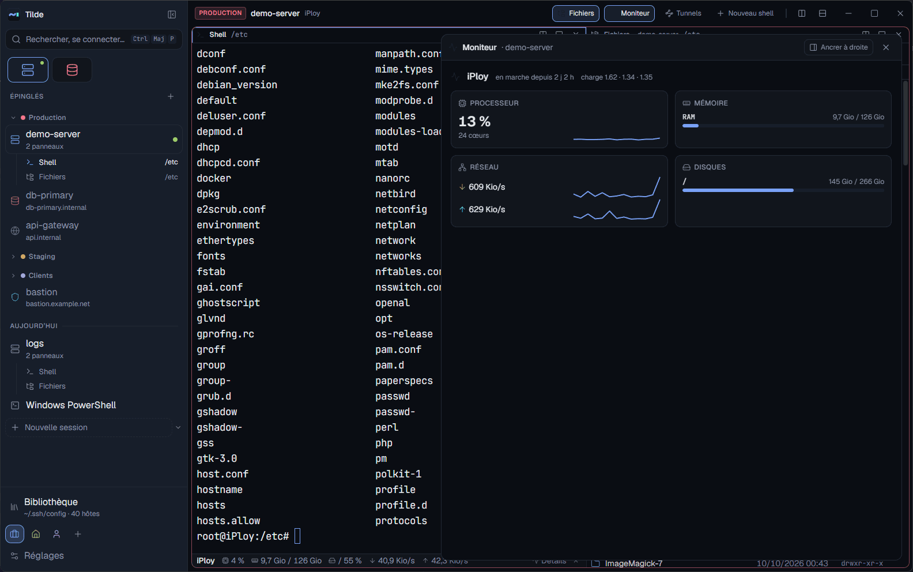
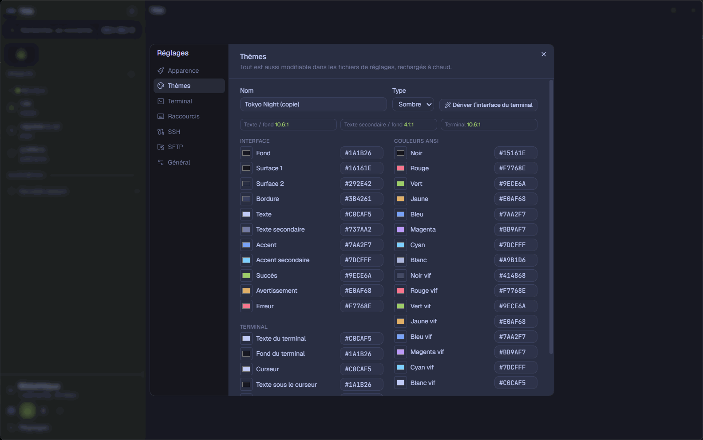
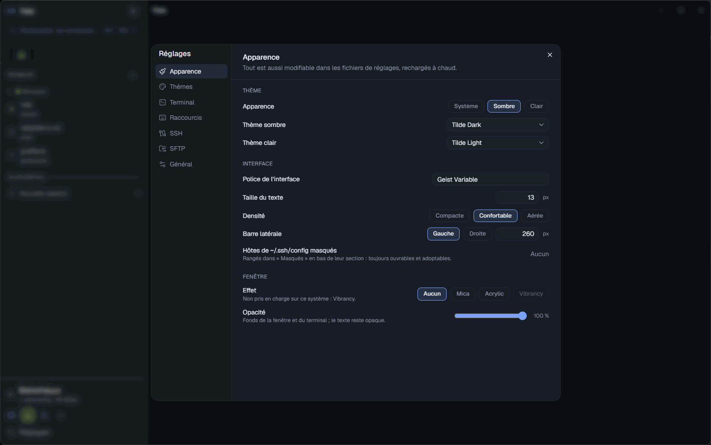
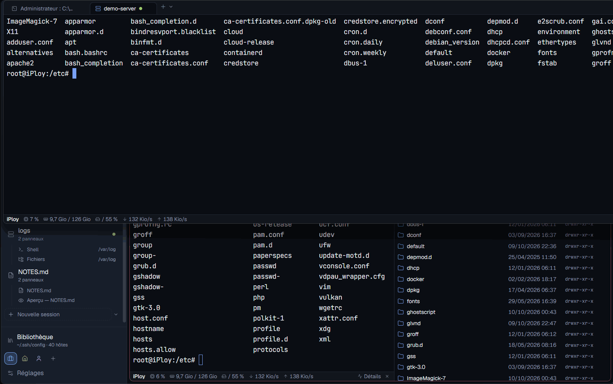

<div align="center">



# Tilde

**An SSH-first terminal that connects on the first try — jump hosts, SFTP and a polished UI,
free and open source.**

[](https://github.com/AlxFrst/tilde/actions/workflows/ci.yml)
[](https://github.com/AlxFrst/tilde/releases)
[](#license)


English · *[Français](README.fr.md)*



</div>

---

## Why Tilde

Most terminals treat SSH as an afterthought. The rest put jump hosts behind a subscription, or
drop connections without saying why. Tilde starts from the other end.

- **It just works with your setup.** Your `~/.ssh/config` is read as OpenSSH reads it:
  `Include`, `Match`, `ProxyJump` chains, `ProxyCommand`, your agent, your `known_hosts`.
  Double-click a host behind two bastions and you get a shell.
- **Failures explain themselves.** You get "key refused", "host unreachable", "fingerprint
  changed" or "timeout on bastion #2", never a spinner that gives up silently.
- **Everything around the shell is built in:** files over the same connection, an editor,
  previews and a system monitor, as panes beside your terminal.
- **No account, no subscription, no telemetry.** Secrets live in your OS keyring and nowhere
  else.

## Features

### SSH that handles the hard cases
- Password, key (with passphrase), agent (OpenSSH for Windows, Pageant, `ssh-agent`) and
  keyboard-interactive / 2FA.
- **Jump hosts**: chained `ProxyJump`, with each hop verified and authenticated, plus
  `ProxyCommand`.
- **`known_hosts`** compatible with OpenSSH: hashed entries, ports, patterns, `@revoked`. A
  changed fingerprint is refused unless you explicitly replace it.
- Keepalive and **automatic reconnection** with backoff; port **forwards** (local and remote)
  that survive reconnections.
- Saved passwords and passphrases go to the **OS keyring** only, never to a file, log or
  export.

### Connections at hand
- A sidebar with favourites, recents, coloured folders, tags and icons, plus your
  `~/.ssh/config` hosts (read-only, one click to adopt).
- Fuzzy search, and a **command palette** (`Ctrl+Shift+P`) for every connection and command.
- Import and export of connections as JSON, **without any secret**.

### Files (SFTP) on the same connection
- A file pane next to the SSH terminal: no second login, and it comes back after a
  reconnection.
- It **follows your `cd`** (OSC 7; Tilde offers the one-line snippet if your shell doesn't
  report it).
- Upload by drag and drop, download, rename, delete, `chmod`. A transfer queue shows speed,
  time left, cancel, and **resume**.
- **Edit remote files** in the built-in editor or in your own (`code --wait`…). A file changed
  on the server in the meantime is never overwritten silently.

### A fast local terminal
- PowerShell 7, Windows PowerShell, cmd, Git Bash and every WSL distribution are detected
  (bash/zsh/fish on Linux and macOS), and custom profiles are supported.
- Tabs and splits, restored at startup; WebGL rendering, ligatures, search, clickable links,
  copy on select, safe multi-line paste.

### Panes beside your shell
- **Editor** (CodeMirror 6): 16 languages, search, Ctrl+S. Conflict detection, Windows line
  endings preserved.
- **Preview**: Markdown (rendered safely), JSON as a foldable tree, images. It follows the
  editor as you type.
- **System monitor**: CPU, memory, network and disks for this machine, or for a Linux server
  read from `/proc` over the SSH connection you already have. Nothing to install.

### Make it yours
- **14 themes** (Tilde, Catppuccin, Tokyo Night, Dracula, Nord, Gruvbox, One, Rosé Pine — dark
  and light). Import from **iTerm2**, **Windows Terminal** or **base16**, and a theme editor
  with live preview.
- **Rebindable shortcuts** with conflict detection (`keybindings.json`).
- **Mica, Acrylic and vibrancy**, plus background opacity.
- **Quake mode**: a global shortcut drops a terminal from the top of the screen.
- Everything is in the settings page **and** in JSON files with a schema (autocompletion in
  VS Code), reloaded live.

## Screenshots

| | |
|---|---|
|  |  |
| SSH, the connection sidebar and the command palette | Files on the same connection, following `cd` |
|  |  |
| Built-in editor with a live preview | System monitor of a server, over SSH |
|  |  |
| Theme editor, imports from iTerm2 / Windows Terminal / base16 | Every setting, also in JSON |

<p align="center"><br/><em>Quake mode</em></p>

## Install

Download the installer for your system from the
[latest release](https://github.com/AlxFrst/tilde/releases/latest):

| System | File |
|---|---|
| Windows 10/11 | `Tilde_x.y.z_x64-setup.exe` (per-user, no admin rights) or `Tilde_x.y.z_x64_en-US.msi` |
| macOS 11+ (Apple Silicon and Intel) | `Tilde_x.y.z_universal.dmg` |
| Linux | `Tilde_x.y.z_amd64.AppImage` (any distribution) or `Tilde_x.y.z_amd64.deb` (Debian, Ubuntu) |

> **The installers are not code-signed yet.**
> - On Windows, SmartScreen shows "Windows protected your PC": choose *More info*, then
>   *Run anyway*.
> - On macOS, right-click the app and choose *Open* the first time.
>
> Each release has a `SHA256SUMS.txt` for checking your download (see
> [docs/release.md](docs/release.md)).

**Updates** are built in. At startup, at most once a day, Tilde asks GitHub whether a newer
version exists and offers to install it. Updates are signed: one whose signature does not
match the key built into Tilde is refused. You can turn the check off in *Réglages → Général*.

> The interface is in **French** for now. An English translation is planned.

## Quick start

1. **Connect**: press `Ctrl+Shift+K`, then type a host alias from `~/.ssh/config` or
   `user@host:port`. Or double-click a host in the sidebar.
2. **Files**: in an SSH tab, press `Ctrl+Shift+E`.
3. **Everything else**: press `Ctrl+Shift+P` and type what you want ("split", "theme",
   "monitor"…).

## Keyboard shortcuts

| Shortcut | Action |
|---|---|
| `Ctrl+Shift+T` / `Ctrl+Shift+W` | New tab / close tab |
| `Ctrl+Tab` / `Ctrl+Shift+Tab` | Next / previous tab |
| `Alt+Shift+=` / `Alt+Shift+-` | Split right / down |
| `Alt+←↑→↓` | Move between panes |
| `Ctrl+Shift+X` | Close pane |
| `Ctrl+Shift+C` / `Ctrl+Shift+V` | Copy / paste |
| `Ctrl+Shift+F` | Search the scrollback |
| `Ctrl+Shift+K` | SSH quick connect |
| `Ctrl+Shift+E` | Files (SFTP) of the SSH tab |
| `Ctrl+Shift+P` | Command palette |

On macOS, `Ctrl` means `⌘`.

- Letters follow the key printed on your keyboard: AZERTY users press the key labelled W for
  `Ctrl+Shift+W`.
- Symbols follow the key's position on a US layout. The welcome screen shows them as printed
  on your keyboard.

Every shortcut can be changed in *Réglages → Raccourcis* or in `keybindings.json`.

## Configuration

Settings are edited in the app (*Réglages*) or in JSON files that come with a schema for
editor autocompletion and are reloaded as you save. An invalid file is reported with its line
and never overwritten; the last valid configuration stays active.

| File | Purpose |
|---|---|
| `settings.json` | every setting (appearance, terminal, SSH, SFTP, Quake, updates…) |
| `connections.json` | saved connections and folders — no secrets |
| `keybindings.json` | your changes to the default shortcuts |
| `themes/*.json` | your themes |

| | Windows | macOS | Linux |
|---|---|---|---|
| Settings | `%APPDATA%\Tilde\` | `~/Library/Application Support/Tilde/` | `~/.config/Tilde/` |
| Logs | `%LOCALAPPDATA%\Tilde\logs\` | `~/Library/Application Support/Tilde/logs/` | `~/.local/share/Tilde/logs/` |

More: the customisation guide [docs/personnalisation.md](docs/personnalisation.md) (themes
format, shortcut syntax, window effects; in French).

## Security and privacy

- **Secrets** (passwords, passphrases) are only ever stored in the OS keyring: Windows
  Credential Manager, macOS Keychain or Secret Service. They are never written to a file, a
  log or an export.
- **Host keys** are verified against OpenSSH's `known_hosts`. Unknown hosts show their
  fingerprint first; changed keys are refused by default.
- **Hardened app**: strict Content Security Policy, and the web view has no file system or
  shell access. Every file operation goes through dedicated, audited Rust commands, and local
  files open only through the system dialog.
- **No telemetry.** The only request Tilde makes on its own is the daily update check, and it
  can be turned off.

Found a vulnerability? Please report it privately: see [SECURITY.md](SECURITY.md).

## Build from source

Requirements: [Rust](https://rustup.rs) (the toolchain in `rust-toolchain.toml` installs
itself), [Node.js](https://nodejs.org) 24+ and [pnpm](https://pnpm.io) 10+, plus the
[Tauri prerequisites](https://tauri.app/start/prerequisites/):

- **Windows**: WebView2 (preinstalled on Windows 10/11) and the Visual Studio Build Tools
  (C++).
- **macOS**: `xcode-select --install`.
- **Debian/Ubuntu**: `sudo apt install libwebkit2gtk-4.1-dev libgtk-3-dev librsvg2-dev
  libayatana-appindicator3-dev patchelf libdbus-1-dev pkg-config`.

```sh
pnpm install
pnpm tauri dev     # run with hot reload
pnpm tauri build   # installers for your platform
```

| Command | Purpose |
|---|---|
| `pnpm test` · `pnpm lint` · `pnpm typecheck` | front-end tests (Vitest), ESLint, TypeScript |
| `cargo test --workspace` · `cargo clippy --workspace --all-targets -- -D warnings` | Rust tests and lints |
| `scripts/ssh-test-env.sh up` then `cargo test -p tilde-ssh --features integration` | SSH tests against a Docker bench with two bastions ([tests/docker](tests/docker/README.md)) |
| `pnpm gen:types` | regenerate the JSON schemas and TypeScript types from Rust |

Releases are built by GitHub Actions from a version tag; see [docs/release.md](docs/release.md).

## Architecture

Tauri 2 with a Rust core and a React + TypeScript front-end:

- **`tilde-ssh-config`**: a hand-written, heavily tested `ssh_config` parser.
- **`tilde-ssh`**: built on `russh`. Connections, jump chains, agent, `known_hosts`,
  forwards, SFTP, transfers.
- **`tilde-pty`** and **`tilde-session`**: local shells and the binary data path, with
  flow control.
- **`tilde-config`**: settings, migrations, hot reload.
- **`tilde-monitor`**: local and remote system sampling.

The UI is built on a panel registry, the contract future plugins will use. See
[docs/architecture.md](docs/architecture.md) and [docs/panneaux.md](docs/panneaux.md) (in
French).

## Roadmap

- [x] Foundations, local terminal, SSH, connections sidebar and palette, SFTP
- [x] Customisation: themes, shortcuts, window effects, Quake mode
- [x] Editor, preview and system monitor panes
- [x] Installers for Windows, macOS and Linux, built-in updates
- [ ] English interface
- [ ] Signed installers
- [ ] Third-party plugins on top of the panel registry

See [CHANGELOG.md](CHANGELOG.md) for what each release contains.

## Contributing

Bug reports, ideas and pull requests are welcome. Please read [CONTRIBUTING.md](CONTRIBUTING.md)
first. In short: tests first, green CI, conventional commits.

## License

Tilde is dual-licensed under either of:

- [MIT](LICENSE-MIT)
- [Apache License 2.0](LICENSE-APACHE)

at your option.
